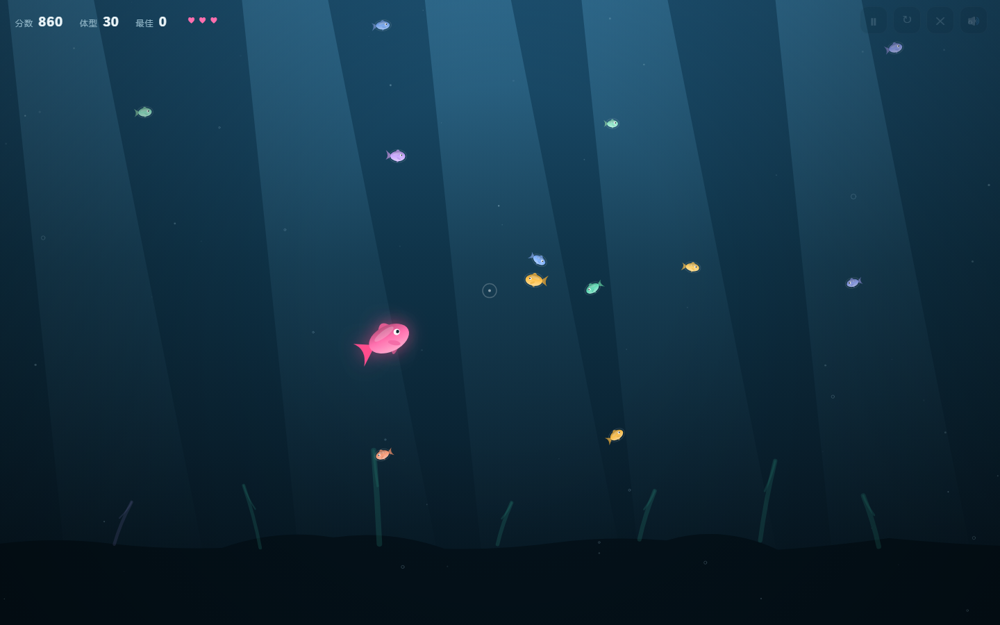

# 大鱼吃小鱼 · Fish Eats Fish

一个用原生 Canvas 写的极简小游戏:吃掉比你小的鱼长大,躲开比你大的鱼。

**[在线试玩 →](https://mjx0414.github.io/fish-eats-fish/)**



## 玩法

| 操作 | 说明 |
| :-- | :-- |
| 鼠标 / 手指 | 鱼会跟着指针游 |
| 方向键 / WASD | 键盘控制,适合没有鼠标的时候 |
| `P` / `Esc` | 暂停 / 继续 |
| `R` | 重新开始(任何时候) |
| 右上角按钮 | 暂停、重新开始、退出、声音开关 |

规则很简单:

- 吃掉**比你小**的鱼 → 体型变大、分数增加
- 撞到**比你大**的鱼 → 掉一条命(共 3 条),并且有 1.8 秒无敌时间
- 两条**差不多大**的鱼 → 互相弹开,谁也吃不了谁

## 为什么做这个

我在补编程基础,需要一个「小到能做完、又能覆盖完整流程」的项目:

输入处理 → 游戏循环 → 碰撞检测 → 状态管理 → 部署上线。

一个只会写 `for` 循环的人和一个能把这个游戏从头写完的人,差别不在语法,在这条完整流程上。

## 技术说明

| 项 | 说明 |
| :-- | :-- |
| 渲染 | Canvas 2D + `requestAnimationFrame`,按 delta time 更新,与帧率无关 |
| 依赖 | **零**。没有框架、没有构建步骤、没有图片资源,所有图形都是代码画的 |
| 体积 | 三个文件合计约 33 KB,其中游戏逻辑 928 行(含中文注释) |
| 适配 | 桌面键鼠 + 移动端触摸,DPR 自适应(最高 2x) |

## 本地运行

直接双击 `index.html` 就能玩。

想用本地服务器(推荐,行为和线上一致):

```bash
python -m http.server 8000
```

然后打开 <http://localhost:8000>。

## 设计取舍

写这个项目时做的几个决定,以及为什么:

**为什么不用游戏引擎?**
Phaser、PixiJS 都能更快做出来。但我的目的不是"做出游戏",是**练基本功**。手写循环和碰撞,才知道每一帧里到底发生了什么 —— 这比多会一个 API 有用。

**为什么体型按"比例"增长?**
吃掉一条小鱼时,半径增加 `该鱼半径 × 0.12`,而不是固定加几个像素。如果是固定值,前期会长得太快,三十秒就无敌了;按比例增长,前期快、后期慢,曲线自然。

**难度是怎么控制的?**
新生成的鱼,体型按当前玩家体型**按比例**采样:

- 58% 的概率 → 明显更小(食物)
- 28% 的概率 → 差不多大(干扰)
- 14% 的概率 → 明显更大(威胁)

所以玩家越大,场上的鱼也越大 —— 不会出现"后期满屏小鱼、毫无压力"的情况。

**为什么小鱼会逃跑?**
每条鱼额外判断:如果玩家比它大、且距离在 210px 内,就朝反方向加速。没有这段逻辑,鱼像纸片一样匀速飘过,追起来毫无手感;加上之后,"扑食"才有反馈。

**碰撞半径为什么乘 0.72?**
鱼的图形是椭圆(宽 `r`,高 `0.66r`)。用标准圆形碰撞,会在视觉上"还没碰到就被吃掉"。乘一个系数,判定更贴合玩家看到的东西 —— 游戏里,感觉一致比数学精确重要。

## 目录结构

```
index.html    页面结构:HUD、遮罩、画布
style.css     界面样式
game.js       游戏逻辑:状态机、更新、渲染
docs/         截图
```

## 已知限制

- 音效是 WebAudio 实时合成的提示音,没有独立音频文件
- 不存档,刷新后只保留最高分(`localStorage`)
- 鱼的数量固定为 22 条,没做低端机的动态降级
- 没有关卡和道具系统

## 许可

[MIT](LICENSE) —— 随便用,改了也不用告诉我。
